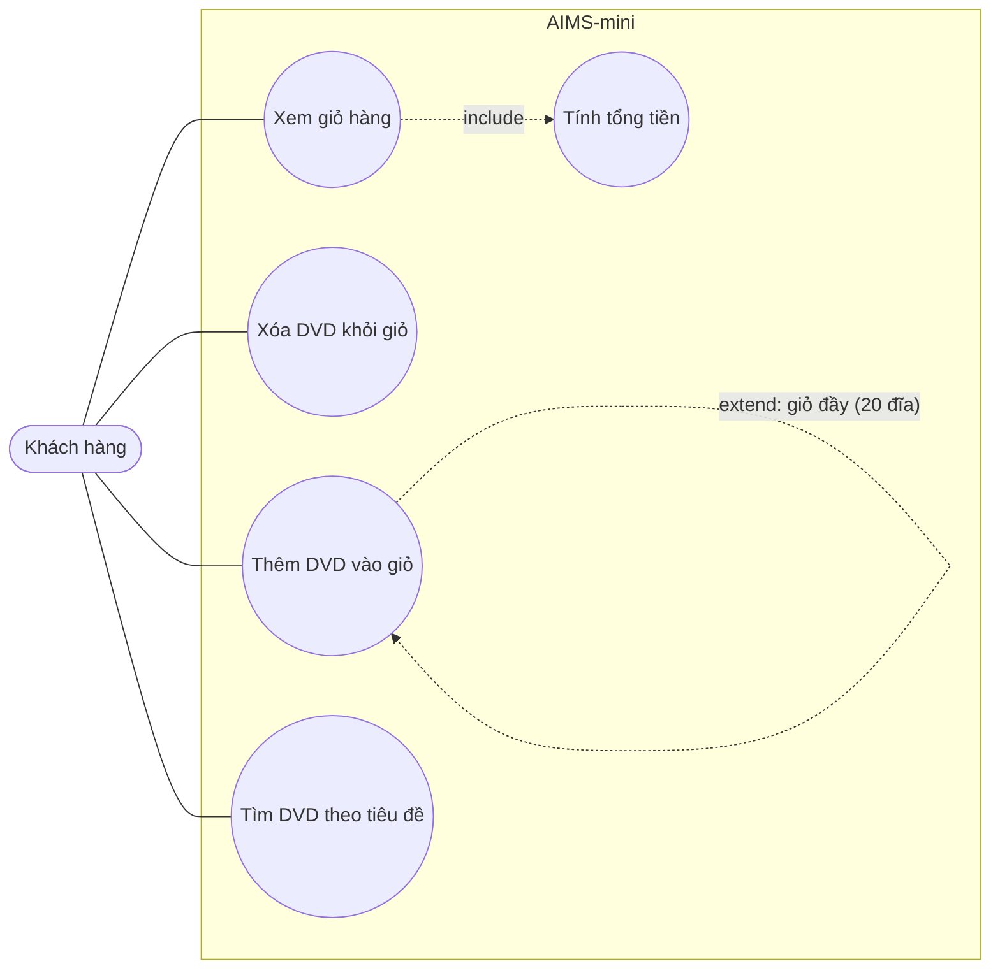

# Use case – AIMS-mini

Tác nhân: **Khách hàng** (người dùng chương trình dòng lệnh).

| Use case | Mô tả | Lớp / hàm hiện thực |
|---|---|---|
| Thêm DVD vào giỏ | Thêm đĩa; từ chối khi giỏ đã đủ `MAX_NUMBERS_ORDERED` đĩa | `Cart.add_dvd` |
| Xóa DVD khỏi giỏ | Xóa đĩa nếu có trong giỏ | `Cart.remove_dvd` |
| Xem giỏ hàng | In danh sách đĩa; giỏ trống in "The cart is empty" | `Cart.print_cart` |
| Tính tổng tiền | Cộng giá của các đĩa trong giỏ | `Cart.total_cost` |
| Tìm DVD theo tiêu đề | Lọc danh sách đĩa theo từ khóa | `search_by_title` |
